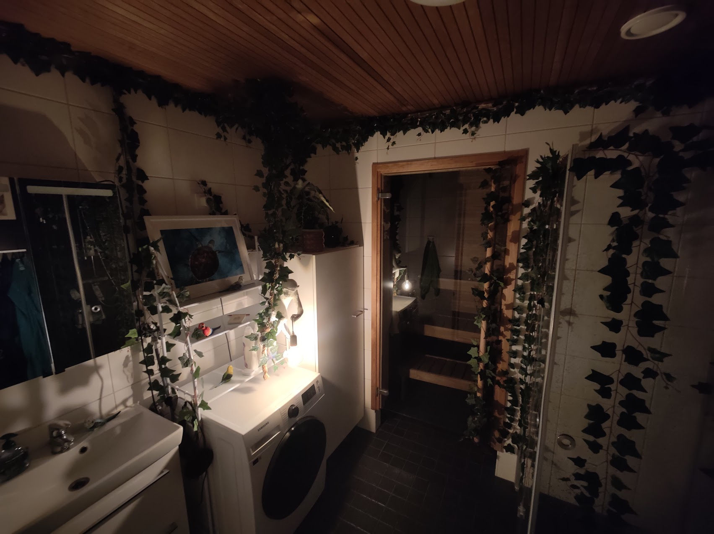
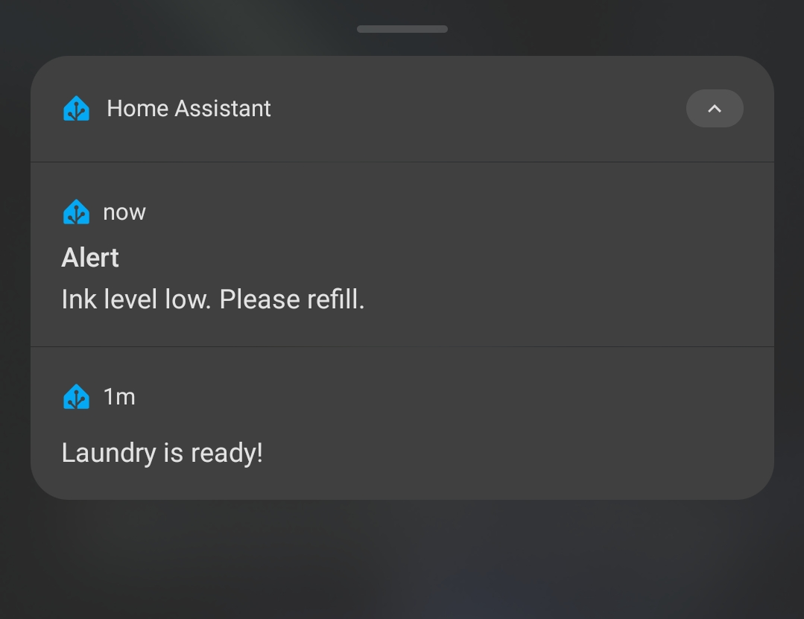
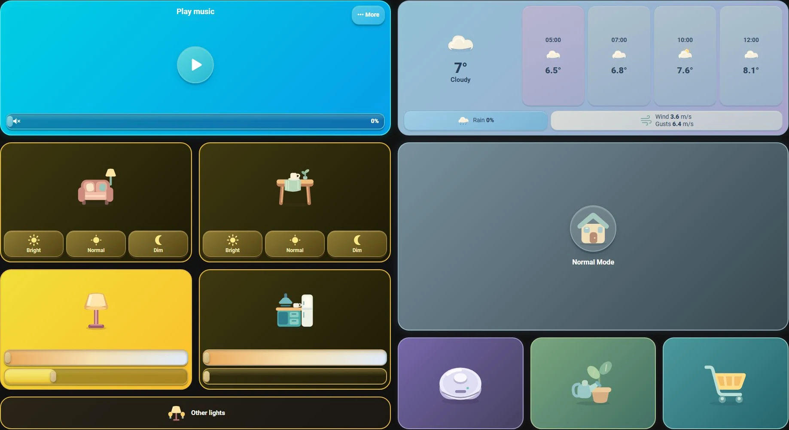

# home-assistant

Documentation of the smart home project I've been building with Home Assistant.

I've been working on this since early 2026. I wanted the home to take care of
more of the things I otherwise have to remember and manage myself.

## Welcome to the Jungle

Our bathroom is called Jungle. There are vines on the walls, birds on the shelves
and a monkey hanging from the ceiling holding a lightbulb. Walk in and the light
comes on, followed by jungle sounds from speakers around the ceiling. During the
day there are birds; late at night, the room settles into crickets. Occasionally
a hidden melody plays in the background.

The sound needs to change while someone is in the room, too. It fades between
clips and follows the time of day, with separate rules for shower visits and
shared music during a sauna session. A Raspberry Pi runs two audio players so
one sound can overlap with the next during a transition.

## Brain's Virtual Memory Extension

Once I could have things happen automatically at home, I wanted that help to
come with me when I went out. My phone already comes with me everywhere, so it
made sense to use it as an extension of my memory. I wanted to have less to keep
in my head and trust that the things I'd otherwise forget would find me when
I could do something about them.

Shopping is one example. I can add something to the list when I notice we've run
out, then get on with whatever I was doing. When I get near a grocery store, my
phone brings up the list. I don't have to remember to check it before leaving
home or try to recall what was missing once I'm standing in the shop. There's
also a catalogue of common products, so adding something doesn't always require
typing it out.

The same idea applies to things waiting at home. The washing machine's smart
plug detects when a load has finished and sends a notification. Plant checks and
repeating household tasks can stay pending until they're done, or be snoozed
until later. Seeing a notification while I'm busy doesn't have to be my only
chance to remember the task.

Some of these reminders are shared between both people living here. If one of
us completes a task, it clears from the other phone too. We aren't both being
reminded about something one of us has already handled.

## Automatic lights, until you say otherwise

Most of the time, I want to walk into a room and have the lights come on by
themselves. But if I then switch one off, it needs to stay off. A motion sensor
noticing that I'm still there shouldn't undo what I just asked for.

That's why the wall buttons are part of the lighting rules. A press can put a
light under manual control, holding it on or off for a while. The override then
expires or resets the next morning, so I don't have to remember to put the room
back on automatic either.

The lighting also follows Time of Day and Vibe Mode. At night, that means fewer,
warmer lights. Keeping the shared modes in one place makes it possible to change
the atmosphere across rooms without adjusting every light separately. Lighting
Studio shows the individual rules, button settings and current manual overrides.

## Music

With music playing in several rooms, I want to be able to change where it plays
without starting the whole session again. Music Assistant handles the playback,
and the music menu brings the living room, balcony and Jungle controls together.
The automatic rules stop ordinary playback at night, but if I press Play, that's
a request to start it now.

One problem was that music and spoken replies shared a volume control on the
living-room voice device. Turning the music down to zero could also make the
assistant inaudible. The device now has separate Music and Assistant levels, so
I can mute the music and still hear a reply. That needed a firmware change;
the [audio notes](docs/selected-builds.md#separate-music-and-assistant-volume)
explain what changed underneath those two sliders.

The Hub brings the everyday controls together. The
[interface gallery](docs/interface.md) also shows the music popup, shopping
catalogue, plant menu and lighting editor.

## Voice control in Finnish

Getting the voice device to wake reliably took some work. The English wake
word didn't respond well to my Finnish pronunciation, and the
early custom models still needed too many attempts in the room.

Changing sensitivity wasn't enough, so I recorded my own pronunciation from
different places in the room and used those recordings to refine the model.
The current **Hei Jarvis** version has been working well for me. The
[wake-word notes](docs/selected-builds.md#finnish-wake-word) include the small
offline comparison as well as the room test. The stock wake word is still
available as a fallback.

On the phone side, there's Habibi, an Android assistant project connected to
Home Assistant.

## Keeping it running

The more I add to the setup, the less I want to be the one who first notices
that something has stopped working. Home Assistant monitors the Jungle audio
players and can try to recover them when they disconnect.

There have also been problems outside the automations themselves. Old
development rollback copies recently filled the hub's storage and blocked
backups. Those archives have been moved off the hub, and warnings now cover low
disk space, failed backups and backups getting too old. The
[testing notes](docs/testing.md) cover the checks made so far and the parts that
still need testing.

## More about the setup

Home Assistant Green is the main controller, with Zigbee2MQTT and a mix of Wi-Fi,
Zigbee and Matter devices. The Jungle audio Pi and living-room Voice Preview
Edition handle the room audio and voice functions.

The [system overview](docs/how-it-works.md) explains how the main parts connect.
The [technical notes](docs/selected-builds.md) go into shared reminders, separate
audio levels and the Finnish wake word in more detail.

The published [automation YAML](automations.yaml) is a snapshot for reference.
The setup also uses scripts, packages, custom integrations and private settings,
so that file alone won't recreate it. Configuration exports are kept separately
from these pages; a routine config change doesn't rewrite the project text.
