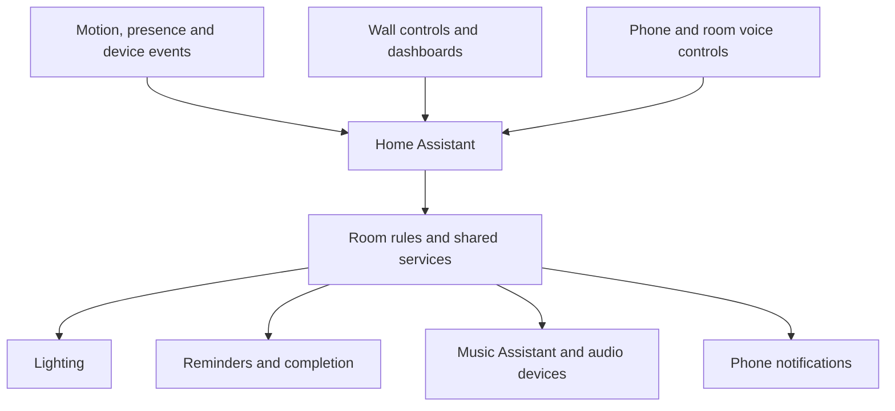

# How the pieces fit together

[Back to the home](../README.md)

Home Assistant Green holds the state and coordinates the rules. The useful
distinction is between what the house knows, what it decides, and what actually
changes a light or starts a sound.

## Rules before individual devices

Time of day and the chosen atmosphere are shared inputs. A room can then add
its own occupancy and manual-control rules. This keeps the meaning of Night or
Maintenance in one place instead of giving every automation a different idea of it.

Those priorities still need exceptions. Automatic music stops for the night,
but a person pressing Play can start it deliberately. A manual light choice
should not immediately lose to a motion event. These are explicit decisions in
the rules, rather than accidents of which automation happened to run last.

## Shared actions

The notification manager is shared by reminders, plant checks and repeating
tasks. Individual features decide when something is due; the manager deals with
sending it, keeping it pending, and handling Done or Snooze.

The room sound system has a similar split. The library describes sounds and
their settings; the controller handles playback, fades and interruptions. That
makes it possible to adjust a sound without rebuilding the controller around it.

The configuration is spread across ordinary HA automations, reusable scripts,
feature packages and a small set of custom integrations. Reading only
`automations.yaml` misses much of the implementation.

## Local and cloud work

Motion, buttons and room rules are coordinated in HA. The Finnish wake-word
model runs on the living-room voice device. That does not make the whole voice
assistant offline: transcription, conversation or speech can involve external
services, depending on the selected pipeline.

Jungle audio runs on a separate Raspberry Pi through two Squeezelite players.
They are overlapping playback paths for the same room, rather than two different
rooms. Music Assistant also manages shared music and other selected outputs.

## Recovery has limits

Reconnect handling, saved task records and startup reconciliation cover several
ordinary interruptions. They cannot make a full disk harmless or replace a
usable backup. Private config history helps recover an edit; HA backups also
preserve registrations and data that are deliberately absent from the public repo.

I try to keep a local control available where it matters, preserve manual
choices during recovery, and test the recovery path instead of assuming that
valid YAML means the feature works.
