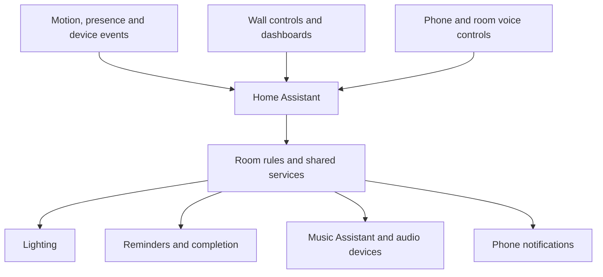

# System overview

[Back to the project](../README.md)

Home Assistant Green is the main controller. The configuration includes HA
automations, reusable scripts, feature packages and custom integrations. This
page covers the main parts and how they connect.

## Lighting and modes

Time of Day and Vibe Mode are shared settings used by several features. Room
rules add motion, occupancy and manual control. This keeps the mode definitions
in one place instead of repeating them in each automation.

A wall button can put a light under manual control for a while. Motion events
then respect that choice until the override ends. Other features have similar
exceptions: automatic music stops at night, but pressing Play can still start it.

## Reminders

Reminders, plant checks and repeating tasks use the same notification manager.
Each feature decides when something is due. The manager sends the notification,
keeps track of the pending occurrence, and handles Done and Snooze.

Shared reminders use one completion record for both phones. The task records
are stored in HA's native to-do storage. More detail is in the
[reminder notes](selected-builds.md#shared-reminders).

## Audio

Jungle audio runs on a separate Raspberry Pi with two Squeezelite players. Both
serve the same room; the second player allows one sound to fade into another.
The sound library holds the clips and their settings, while the controller
handles playback, fades and interruptions.

Music Assistant manages music and the selected outputs around the home. The
living-room voice device has custom firmware for independent music and assistant
volume. Its hardware output is shared, but each audio source has its own volume
adjustment before reaching it.

## Voice

The Finnish wake-word model runs on the living-room voice device. The rest of
the voice pipeline can use external services for transcription, conversation
and speech, depending on the selected pipeline.

Habibi is a separate Android assistant project connected to HA.

## Restarts and backups

Saved task records, reconnect handling and startup checks help restore the setup
after an interruption. Manual choices also need to survive recovery where
appropriate, so a reconnect doesn't unexpectedly change what someone selected.

Private configuration history is useful for recovering edits. HA backups also
include the registrations and stored data needed to restore the home. The public
repository contains only part of the configuration.
