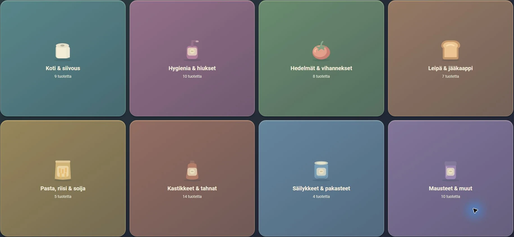
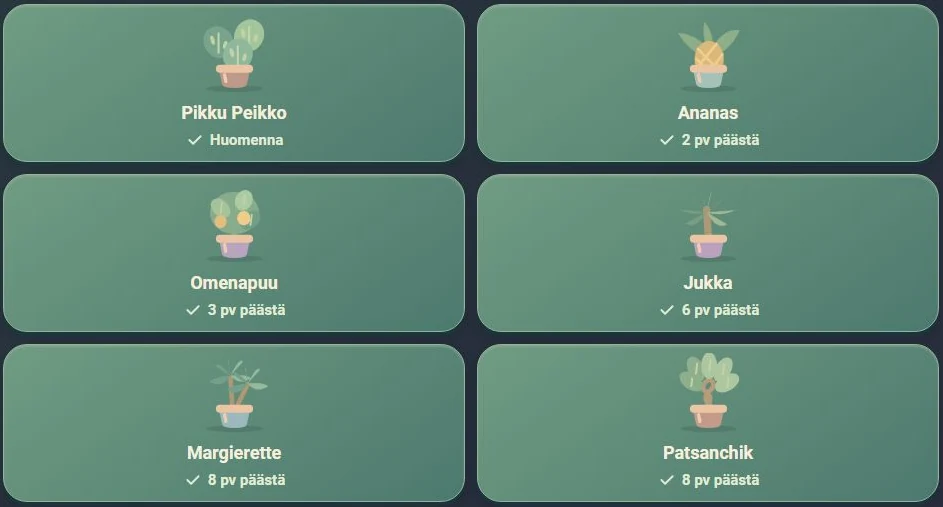
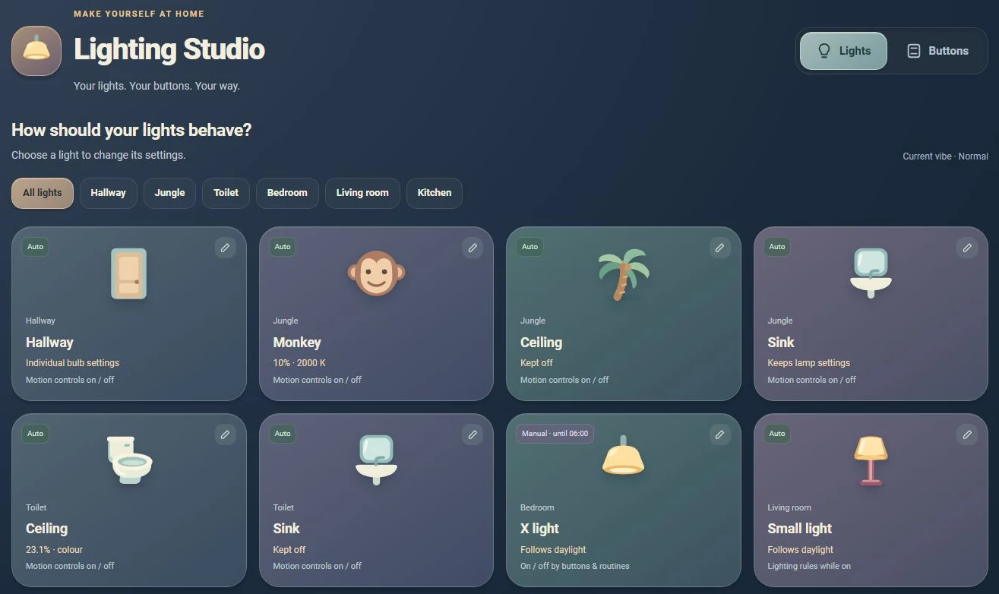
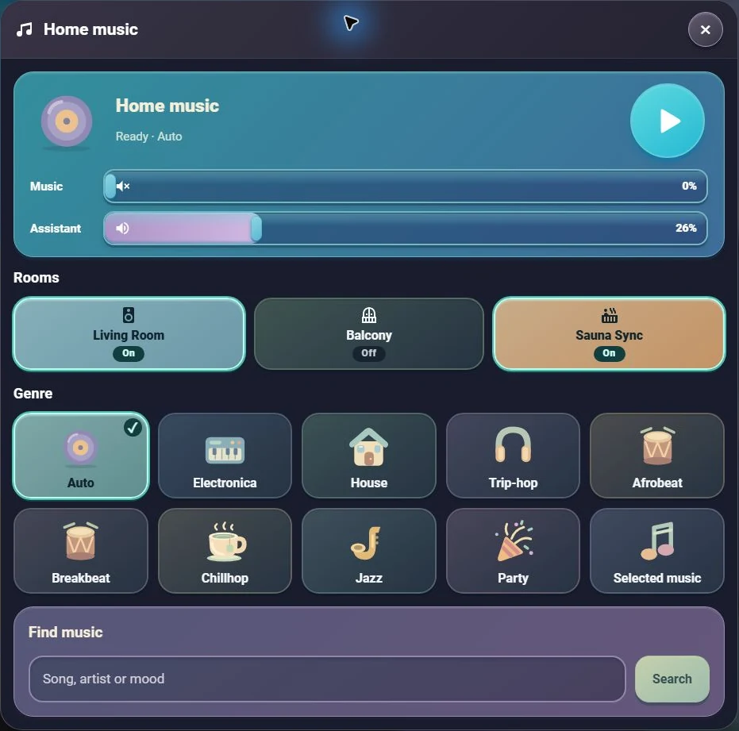

# A look around the controls

[Back to the home](../README.md)

These are screenshots of the installed Home Assistant interface, captured in
October 2026. They show the controls as they were at that moment. The crops leave
out account controls and reminder recipients; the interface itself is unchanged.
Some household menus are in Finnish.

## Shopping

The catalogue groups ordinary purchases into categories, from household supplies
to fruit and vegetables. It is a shortcut for adding products to the shopping
list. The counts here describe the catalogue, rather than what needs buying.

## Plants

Part of the plant menu, with the next check shown on each card. “Huomenna” means
tomorrow; “3 pv päästä” means in three days. The scheduling and shared reminders
are described in the [reminder build notes](selected-builds.md#a-reminder-that-is-still-the-same-reminder-tomorrow).

## Lighting

Lighting Studio brings the rules for individual lights into one place. The cards
show the selected behaviour, including lights kept off, daylight-following lights
and a manual choice held until a particular time.

## Music

Music and Assistant have separate levels. Here music is at zero while the
assistant remains at 26%. Below them are the room choices, genre shortcuts and
search. The [audio build notes](selected-builds.md#giving-music-and-speech-different-volume-controls)
explain what had to change underneath those two sliders.
